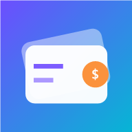

  

<h1 align="center">Expense Manager</h1>

  Track your spending at home and on your trip, and know exactly how much to keep in your account before you leave.

  <a href="https://omerfauzan.github.io/expense-manager/"><b>👉 Open the app</b></a>

---

## 📲 Install on iPhone

1. Open **https://omerfauzan.github.io/expense-manager/** in **Safari**
2. Tap **Share** (the square with ↑)
3. Tap **Add to Home Screen** → **Add**

It opens full-screen like an app and works offline.

On Android, open the link in Chrome and tap **⋮ → Add to Home screen** (or **Install app**).

## ✨ Features

- **Trip countdown**: an animated flight tracker counts down to departure, then shows "Day X of Y" and a daily spending allowance during the trip
- **Two phases**: expenses at home (before the trip) and at your destination, each in its own currency
- **Quick add**: a big amount pad, 12 categories, and live conversion between currencies
- **Charts**: a donut chart by category, the last 14 days, and budget progress bars
- **Money plan**: enter your balance, income, and the bills that keep running while you're away (rent, phone, loans). It tells you **how much to keep in your account** and how much is **free to take on the trip**
- **Live exchange rate**: one tap fetches today's rate, or you can enter your own
- **Any trip**: pick from 26 currencies and any countries, not just Australia → India
- **Private**: all data stays on your phone. No account, no server
- **Backup and restore** (JSON) and **CSV export** for Excel

## 🔒 Your data

Everything is stored only in your browser on your device. Nobody else, including the app's author, can see it. Use **Settings → Backup** before changing phones.

## 🛠 Tech

A single `index.html` with no frameworks or build step, plus a web app manifest and a service worker for offline use. It's hosted on GitHub Pages.
